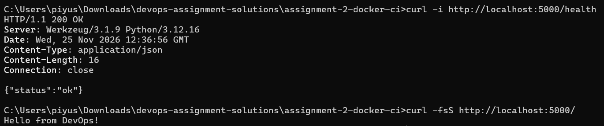

# Assignment 2 · Docker and GitHub Actions

This repository includes the assignment's Flask app, its dependency file, a Dockerfile, and a workflow at `.github/workflows/build.yml`. Start in the folder containing this README.

## 1. Check Docker

```bash
docker version
```

**Checkpoint:** The output includes both a Client and a Server section. On Windows with WSL, start Docker Desktop and enable integration for your Ubuntu distribution. [Docker Desktop WSL integration](https://docs.docker.com/desktop/features/wsl/)

## 2. Build the image

```bash
docker build -t devops-flask:local .
docker image ls devops-flask
```

The Dockerfile sets `/app` as the working directory, installs Flask from `requirements.txt`, copies `app.py`, and starts it with `python app.py`. The final dot in `docker build` selects the current directory as the build context. The base image supplies Python 3.12. [Official Python Docker image](https://hub.docker.com/_/python)

**Checkpoint:** The image list shows repository `devops-flask` and tag `local`.

## 3. Run the container and verify the endpoints

```bash
docker run -d --name devops-flask -p 127.0.0.1:5000:5000 devops-flask:local
docker ps --filter name=devops-flask
curl -i http://localhost:5000/health
curl -fsS http://localhost:5000/
printf '\n'
```

**Checkpoint:** The container is `Up`, Docker shows `127.0.0.1:5000->5000/tcp`, `/health` returns HTTP `200` with `{"status":"ok"}`, and `/` returns `Hello from DevOps!`. If you query immediately after starting the container and the app is still starting up, try the curl command again after a few seconds.

### Health-check evidence

In this Docker run, `curl -i http://localhost:5000/health` returned `HTTP/1.1 200 OK` with `{"status":"ok"}`. The request to `/` returned `Hello from DevOps!`. [Docker port publishing](https://docs.docker.com/engine/network/port-publishing/)



After capturing your output, stop and remove the container.

```bash
docker stop devops-flask
docker rm devops-flask
```

## 4. Diagnose why the app cannot be reached

The supplied Flask app already binds to `0.0.0.0:5000`. An exact finding for the teammate's setup requires their Dockerfile and run command. Use these checks to identify which problem applies.

```bash
docker ps -a --filter name=devops-flask
docker logs devops-flask
docker port devops-flask
```

| Problem | What to check | Fix |
| --- | --- | --- |
| Flask binds only to container loopback | The app uses `127.0.0.1` or the default Flask bind. | Set `app.run(host="0.0.0.0", port=5000)`. |
| Container port is unpublished | `docker port devops-flask` shows no mapping. `EXPOSE 5000` documents the port. | Recreate the container with `-p 127.0.0.1:5000:5000` to publish the port locally. |
| Port numbers are mismatched | The mapping's right-hand port differs from Flask's listening port, or curl uses the wrong left-hand port. | Map host port `5000` to container port `5000` and curl `localhost:5000/health`. |
| Flask dependency is missing | The container exited and its logs show `ModuleNotFoundError: No module named 'flask'`. | Copy `requirements.txt` into the image and run `python -m pip install --no-cache-dir -r requirements.txt` while building. Rebuild and recreate the container. |
| The app fails to start | The container exited and its logs show that Python cannot open `app.py`. | Set `WORKDIR /app`, copy `app.py` into it, and use `CMD ["python", "app.py"]`. Rebuild and recreate the container. |
| Host port 5000 is already in use | `docker run` reports a port allocation or bind error. | Free host port 5000 and recreate the container. To verify temporarily on another port, use `-p 127.0.0.1:5001:5000` and curl `localhost:5001/health`. |
| Curl reaches the app but receives HTTP 404 | Flask answers at the published port with a route error. | Request the exact `/health` path on the container running the provided app. |

## 5. Push and check GitHub Actions

Create a second empty GitHub repository named `assignment-2-docker-ci`. Use visibility that lets your instructor see your work. Commit the README and its screenshot together so the image displays on GitHub.

```bash
git init -b main
git add README.md app.py requirements.txt Dockerfile .github/workflows/build.yml docs/screenshots/docker-health-check.png
git diff --cached --name-only
git commit -m "Dockerize Flask app and build it on every push"
git remote add origin https://github.com/YOUR-USERNAME/assignment-2-docker-ci.git
git push -u origin main
```

The `push` trigger has no branch or path filters. The workflow checks out the pushed commit, then runs `docker build -t devops-flask:ci .` on a GitHub-hosted Ubuntu runner. The image is built on the runner. [GitHub push event](https://docs.github.com/en/actions/reference/workflows-and-actions/events-that-trigger-workflows#push)

**Checkpoint:** `git diff --cached --name-only` lists `.github/workflows/build.yml` before the commit. After pushing, open **Actions → Build Docker image → build** on GitHub. Confirm the run matches your commit and both **Check out repository** and **Build image** are green.
